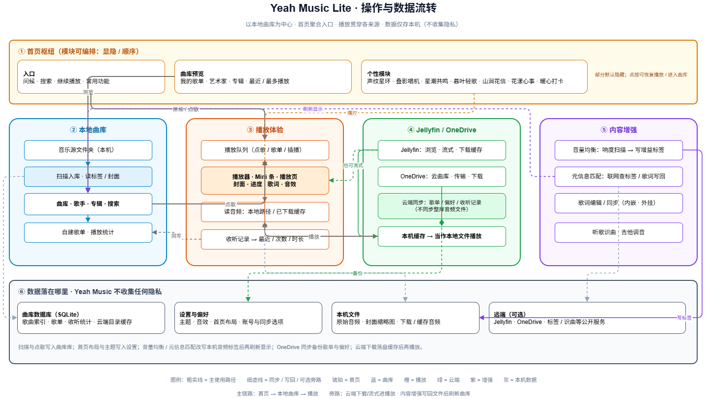
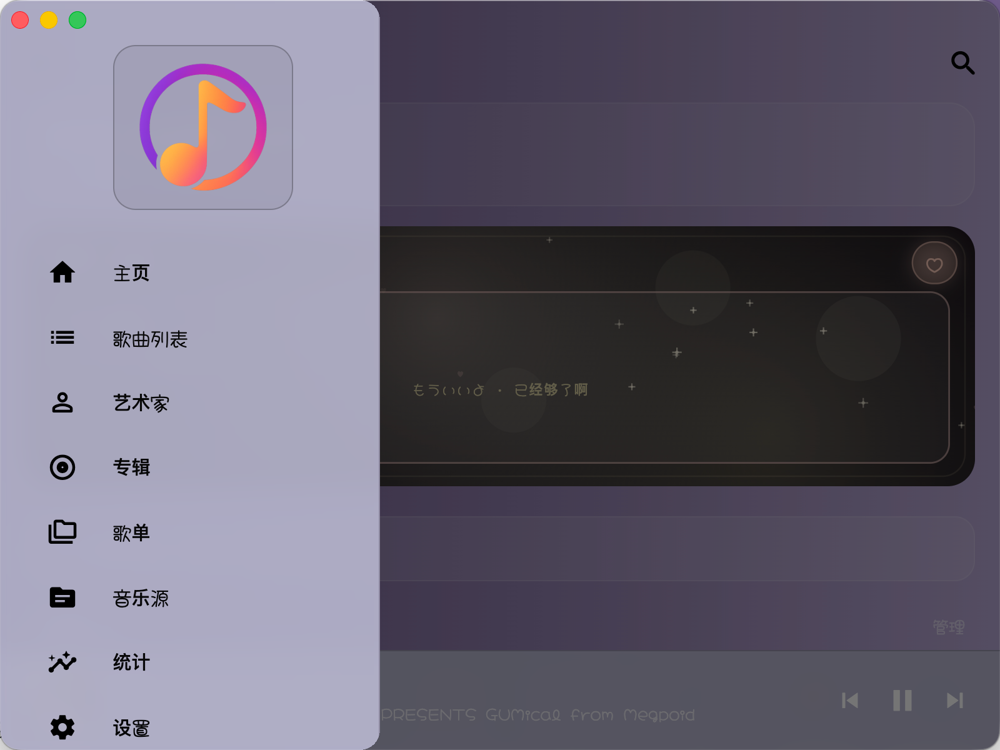
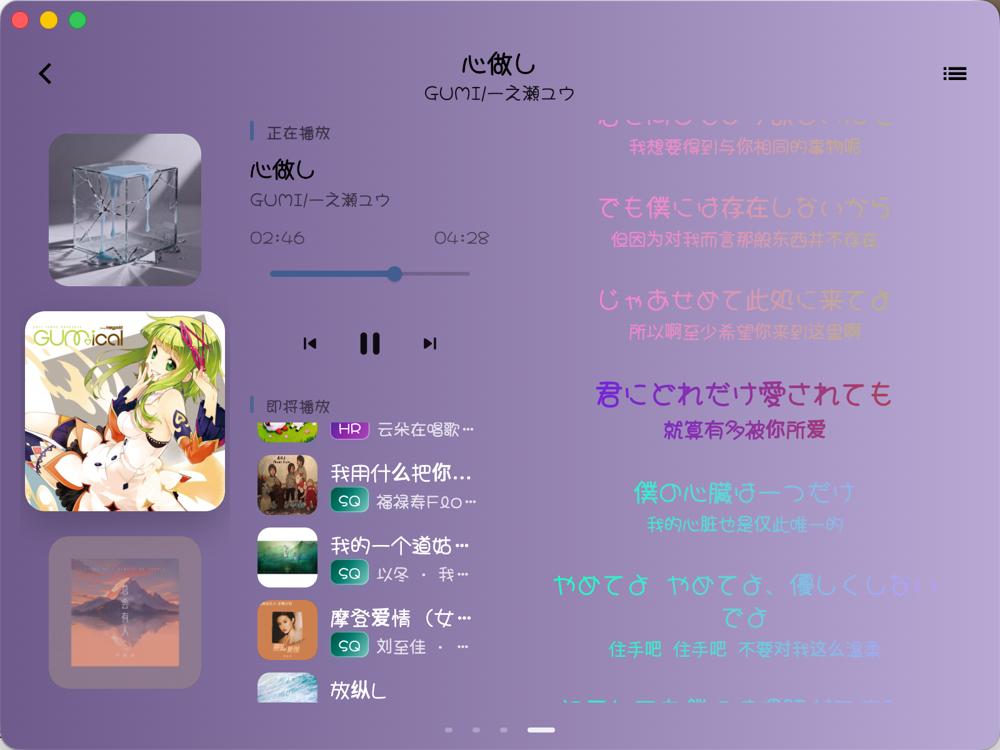
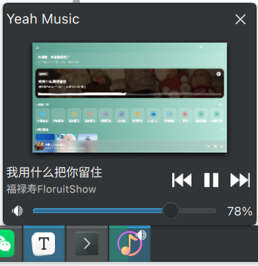

    

简洁、现代化的跨平台音乐播放器

# Yeah Music 🎶

**Yeah Music** 是一个基于 **Flutter** 开发的跨平台音乐应用，基于我个人使用场景而开发的本地音乐播放器，完全免费，不设置任何 VIP 或者付费解锁的功能，希望也能为同样喜欢本地音乐的你带来纯粹、轻松的使用体验。

> 补充：  
> 从 `2.0.0` 版本开始，因为一些原因（非技术原因），无法继续公开源码，本仓库只做发包使用；  
> 所发布的 **Lite** 公开版本绿色安全，可以放心使用；  
> 如不信任或不慎安装该 APP，卸载即可；  
> 本仓库内源码，以供学习交流使用。

---

## 下载地址

GitHub Release（推荐）：https://github.com/pengweizhong/yeah_music/releases  
夸克网盘（备用）：https://pan.quark.cn/s/38af466474d0

---

## ✨ 功能特性

### 🎶 本地音乐入库

- 多目录扫描，本地音频一键纳入曲库
- 支持格式：`mp3 / m4a / wav / flac / opus / ogg`
- 多歌单，支持高度自定义
- 曲库统计图表化，手机与桌面都更好用
- 自 v5 起曲库索引改用 **SQLite**（大曲库更稳）；升级后请重新添加音乐源并扫描

### 🏠 首页枢纽

- 模块可编排：显隐 / 顺序自由调整
- 入口：问候 · 搜索 · 继续播放 · 常用功能
- 曲库预览：我的歌单 · 艺术家 · 专辑 · 最近 / 最多播放
- 个性模块：声纹星环 · 叠影唱机 · 星潮共鸣 · 暮叶轻歌 · 山涧花信 · 花漾心事 · 暖心打卡（部分默认隐藏）

### 🎧 播放体验

- 统一队列承接本地 / Jellyfin / OneDrive 等来源
- 迷你条 → 播放页：封面 · 进度 · 歌词 · 音效
- 播放模式 · 休眠定时 · 均衡器 · 倍速等
- 桌面端支持多播放页扩展、窗口位置/大小记忆

### 🧾 元信息管理

- 自动读取内嵌标签、封面与歌词（不支持外链歌词和封面）
- 支持编辑内嵌标签与歌词相关信息
- 可重新加载嵌入数据，修正元信息不同步 / 缺失
- 查询时可预览波形并点击跳转播放

### 📚 歌词体验

- 多行歌词 / 多翻译按同一时间戳自动渲染
- 三种状态颜色 / 渐变：正在播放 / 已播过 / 未播到
- 可调字体大小、行距、对齐方式；点击行可定位进度
- 支持在通知与车机场景显示歌词（跟随歌词样式设置）
- 可以自己创作编写歌词，内置**歌词同步**组件已提供支持

### 🖥️ 桌面歌词

- 悬浮歌词窗可拖动、可锁定位置
- 背景透明度可调
- 与播放页同一套歌词样式（颜色、多行、翻译等）
- 可设置当前行前后各显示多少条「按时间轴分段」的歌词

### 🎛️ 主题与 UI

- 背景：纯色 / 自定义强调色 / 壁纸（模块化）
- 自定义字体 · 渐变背景
- 壁纸可雾化与压暗，提高界面辨识度

### 🎚️ 音效与听感

- **音量均衡**：按曲 / 按专辑扫描并写入 ReplayGain；可暂停后续写、覆盖已有标签；播放页「更多」可查看本曲增益
- 均衡器与音量均衡合并在「音效」页；预设图标按效果区分

### 🎸 吉他调音

- 常用功能内本地听音调音
- 标准 / 降半音 / Drop 等预设；逐弦引导与参考音；可调 A4（默认 440Hz）

### 🖥️ Jellyfin

- 独立浏览：歌曲 / 专辑 / 艺术家 / 流派 / 播放列表
- 流式播放与下载缓存；与 OneDrive 共用统一传输队列
- 按网络自动选码率；播放上报、歌单管理与搜索等

### ☁️ OneDrive 云端

- 云端曲库：索引网盘音乐文件夹，下载 / 删除、按需缓存、离线播放
- OneDrive 浏览器：浏览云盘目录，查看并播放音频
- 传输队列：批量上传 / 下载
- 本地上传：曲库多选或单曲上传
- 云端备份：歌单与设置等按需同步，支持从云端恢复；可导出本地 zip
- 缓存并入曲库：已落地文件与「音乐源」扫描结果合并为统一曲库

### 🖥️ 跨平台支持

- Android
- macOS
- Linux（KDE / GNOME）
- Windows

---

## 🗺️ 业务架构（Lite）

Yeah Music 以 **本地曲库** 为中心：首页聚合入口，播放体验贯穿各来源；Jellyfin / OneDrive 扩展内容获取；标签 / 歌词 / 识曲 / 音量均衡增强曲目信息。数据仅存本机，**不收集隐私**。

  

**读图提示**

| 域 | 做什么 |
| --- | --- |
| 首页枢纽 | 问候、搜索、继续播放、常用功能与曲库预览；个性模块可编排 |
| 本地曲库 | 扫描入库、浏览与自建歌单，是播放与编辑的主数据源 |
| 播放体验 | 统一承接本地 / 云端曲目，叠加歌词与播放控制 |
| Jellyfin / OneDrive | 服务器库与云盘听歌、传输与备份（不同步整库音频） |
| 内容增强 | 音量均衡、元信息匹配、歌词编辑、识曲与调音，结果写回本机 |
| 数据落点 | SQLite 曲库 · 设置偏好 · 本机文件 · 可选远端服务 |

---

## 📊 主要功能 & 各平台适配情况

当前参照版本：**Lite `7.0.0`**

> 色标说明：
>
> - 🟢  功能支持，经测试基本稳定可用
> - 🟡  包含此功能但稳定性一般，或平台差异较大
> - 🔴  本公开包不可用 / 平台未提供
>
> 不方便使用 OneDrive 的客户端，仍可用「导入文件夹配置」等方式做间接同步。

| 功能 / 平台              | Android | macOS   | Windows | Linux（KDE / GNOME） |
|--------------------------| ------- |---------| ------- | -------------------- |
| 本地音乐                 | 🟢       | 🟢      | 🟢       | 🟢                    |
| 在线音乐                 | 🔴       | 🔴      | 🔴       | 🔴                    |
| 首页模块 / 个性装饰      | 🟢       | 🟢      | 🟢       | 🟢                    |
| Jellyfin                 | 🟢       | 🟢      | 🟢       | 🟢                    |
| OneDrive 云端            | 🟢       | 🟢      | 🟢       | 🟢                    |
| 音量均衡 / 音效          | 🟢       | 🟢      | 🟢       | 🟢                    |
| 吉他调音                 | 🟢       | 🟢      | 🟢       | 🟢                    |
| 线控 / 键控 / 系统媒体键 | 🟢       | 🟢      | 🟢       | 🟢                    |
| 封面 / 歌词 / 菜单栏歌词 | 🟢       | 🟢      | 🟢       | 🟢                    |
| 桌面悬浮歌词             | —       | 🟢      | 🟢       | 🟢                    |
| 全局 UI 定制 / 个性化    | 🟢       | 🟢      | 🟢       | 🟢                    |
| 元信息管理               | 🟢       | 🟢      | 🟢       | 🟢                    |
| Android 桌面小组件       | 🟢       | —       | —       | —                    |
| 其他桌面细节             | 🟢      | 🟢      | 🟡       | 🟡                    |

---

## 📄 许可证（License）

**Yeah Music** 使用 **GPL‑3.0** 协议开源。

- 你可以自由使用、修改、分发
- 可以基于它继续做自己的东西
- 但衍生作品需要保持 **GPL‑3.0**
- 也需要保留原作者的版权声明

和我之前的另一个项目 **[Dynamic‑SQL2](https://github.com/pengweizhong/dynamic-sql2)** 不一样，那是 MIT，这个不是。

## APP 效果预览（基于较早桌面（2.0.0） / Android 截图）

### Android

  
  
  
  
  

安卓额外适配了横屏播放效果

### macOS

电脑端支持拓展第三、第四播放页

macOS 额外适配了菜单栏歌词、桌面歌词和 logo 播放进度润色。  

支持切换多行歌词显示模式，最多支持切换 10 种语言（我认为够用了），切换后的歌词会实时同步到菜单栏歌词和桌面悬浮歌词。

### Linux

Linux 桌面下适配了托盘图标，其余界面与 macOS 基本一致。

Ubuntu / KDE 下额外适配了 logo 播放进度润色和托盘区域。

  
  

### Windows

界面与 Linux 基本一致；自 v7 起提供安装包。桌面端细节仍以 macOS / Linux 为主测，Windows 可满足日常使用。

---

## 💬 交流群 & 自愿赞助

### QQ 交流群

群号：**1131319907**（欢迎加入）

  

### 自愿赞助

YeahMusic 是一个人的长期项目。  
我在业余时间持续修复、优化、打磨体验，只因为我喜欢音乐，也喜欢把工具做好。

如果你愿意支持这个小小的播放器继续走下去，  
可以通过自愿赞助的方式表达你的认可。

没有强制，没有诱导，没有付费墙。  
你的每一份支持都会让我非常感激。  

| 微信支付 | 支付宝 |
| :---: | :---: |
|  |  |
